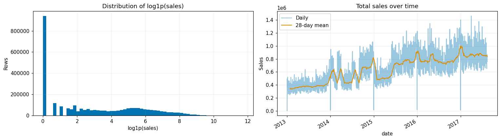
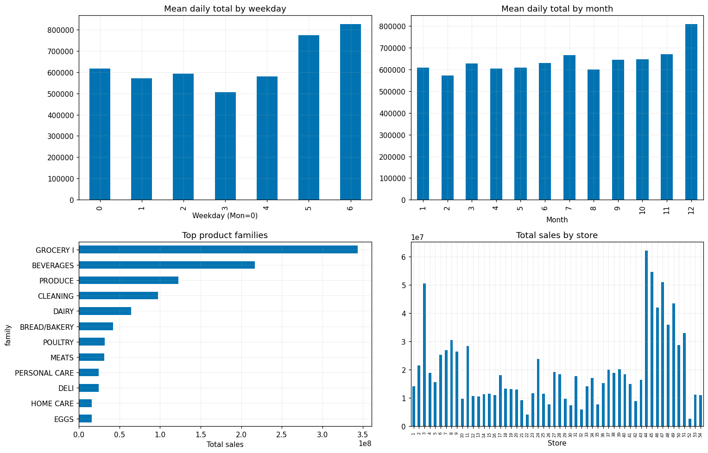
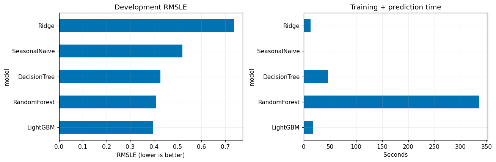
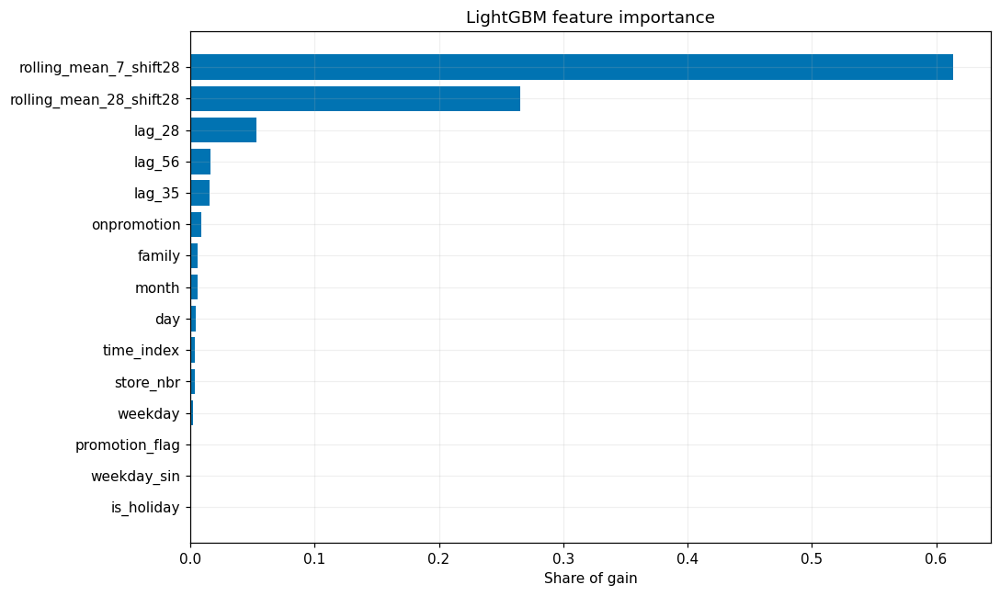
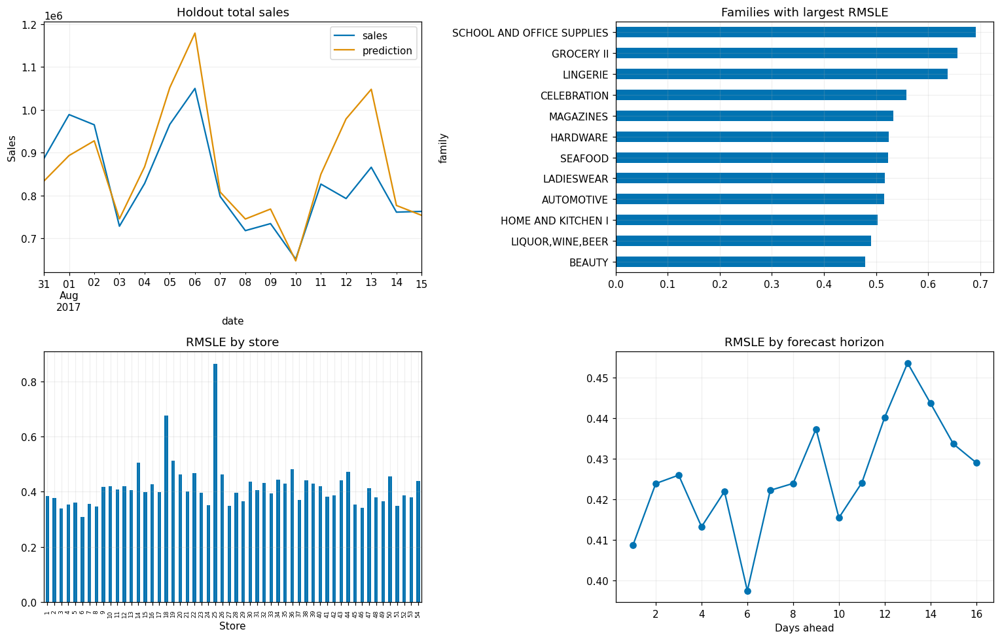
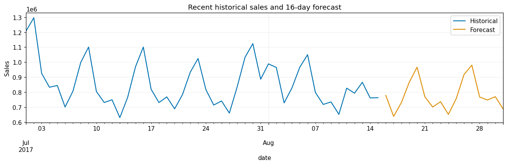

# Store Sales：基础版数据分析报告

课程名称：机器学习

项目数据集：Kaggle – Store Sales: Time Series Forecasting

项目类型：回归预测／日粒度多序列销量预测

报告版本：基础版（与Store_Sales.ipynb对应）

姓名：________________　　学号：________________

班级：________________　　指导教师：____________

报告日期：2026年11月17日

## 摘要

本项目以Kaggle Store Sales: Time Series Forecasting竞赛为研究对象，预测厄瓜多尔54家商店、33个商品品类未来16天的日销量。目标sales表示销量，部分商品按重量销售，数值可以为小数。项目参考课程报告的组织形式，完成数据读取、探索性分析、缺失处理、类别编码、时间回测、多模型比较、LightGBM参数对照、误差分析及测试集预测。

基础实验比较周期基线、Ridge回归、决策树、随机森林及LightGBM。在两个开发窗口中，默认LightGBM的合并RMSLE为0.39697；经过三组参数比较后，选择LightGBM_tuned_3，开发合并RMSLE为0.39144。在当时未参与选型调参的最后16天保留窗口中，取得RMSLE=0.42611、MAE=76.18、RMSE=267.47、R²=0.9541。

确定模型后，按2016年以来的既定训练标签范围重新拟合，生成28,512条正式测试预测。提交ID、预测数值和保留窗口真实标签均经过核验。以上数值均为基础版已有实验结果；本报告整理这些记录，没有新增训练或线上评分。Kaggle Public Score待真实提交后补充。

关键词：销量预测；机器学习；时间回测；LightGBM；特征工程；模型评价

### 报告结构

一、项目背景与研究目标；二、数据集介绍与探索性分析；三、数据预处理与特征工程；四、模型构建与评价方法；五、实验结果与模型比较；六、梯度提升模型参数优化；七、最终模型训练与Kaggle预测；八、结论与不足。

## 一、项目背景与研究目标

商品销量受周内消费习惯、节假日、促销和门店规模等因素影响。预测需求变化有助于安排补货和库存。本任务包含54×33＝1,782条门店—品类序列，需要同时处理销量量级差异、周期性及部分商品长期零销量等问题。

### 1.1 项目目标

（1）分析数据规模、字段、缺失日期、零销量分布和日历周期。

（2）构造可在预测时使用的历史滞后、滚动统计、促销与门店属性特征。

（3）比较周期基线和四种监督回归方法，使用时间窗口而非随机划分评价模型。

（4）对LightGBM进行有限候选参数比较，依据开发窗口锁定最终方案。

（5）检查保留窗口误差与提交格式，形成Notebook、HTML和Word报告。

### 1.2 基础版任务范围

本报告对应根目录Store_Sales.ipynb、Store_Sales.html、submission.csv及artifacts/实验记录。方法为表格时序特征加回归模型；训练标签起点固定为2016-01-01，更早的原始历史用于探索和历史特征查找。算法随机种子固定为42，CPU运行。

项目按时间顺序设置两个开发窗口和一个最后保留窗口。保留窗口在原基础实验中未参与选择，但其结果已经公开记录；本次补写Word仅引用既有结果，不将其描述为新完成的独立盲测。

## 二、数据集介绍与探索性分析

### 2.1 数据文件与规模

| 文件 | 记录数 | 主要用途 | 空值数 |
| --- | --- | --- | --- |
| train.csv | 3,000,888 | 历史销量及输入 | 0 |
| test.csv | 28,512 | 未来16天输入 | 0 |
| stores.csv | 54 | 门店静态属性 | 0 |
| holidays_events.csv | 350 | 节假日、事件及转移信息 | 0 |
| oil.csv | 1,218 | 油价背景分析 | 43 |
| transactions.csv | 83,488 | 交易笔数背景分析 | 0 |
| sample_submission.csv | 28,512 | 提交ID和列格式 | 0 |

训练表共有3,000,888条记录，时间为2013-01-01至2017-08-15；测试表为2017-08-16至08-31，共28,512条。主键为日期、门店及商品品类，id只用于提交对齐，不参与训练。原始主表没有字段空值，但2013—2016年每年的12月25日没有记录，需要区分缺少日期和真实零销量。

### 2.2 销量分布与变化趋势

训练样本中零销量约占31.30%，销量中位数为11。分布右偏，存在少量高销量记录。模型使用log1p(sales)作为回归目标，使训练更关注对数尺度误差，并与RMSLE评价方向一致。销量中的真实零值保留，不被当作缺失。

日总销量呈现长期水平变化和重复波动。图中的28天均线用于描述趋势，不直接作为可以使用未来数据的模型输入。模型的滚动特征另行通过先滞后、再向后滚动的方式构造。

### 2.3 周期性、促销与外部变量

周末的平均日总销量相对较高，不同月份、门店和品类的量级也不同。月份统计使用日均总量，但仍混合跨年发展等因素，不能直接解释为纯季节效应。促销和销量的观察性关系也不能直接证明因果影响。

基础版将油价与交易笔数用于背景分析，不把未来实际油价或交易量输入预测模型。油价表存在43个字段缺失值，不能因此声称主模型已经使用了经过填补的油价特征。

## 三、数据预处理与特征工程

### 3.1 数据连接与日历特征

按store_nbr连接门店城市、州、类型及cluster，验证多对一关系，避免连接产生重复行。将全国、区域和城市节假日与适用门店匹配，并构造节假日、事件及补班标记；转移出去的节日不直接当作原日休假。

时间特征包括星期、月份、日、年份、时间索引、周末、15日或月末的发薪日提示，以及星期正弦和余弦。促销使用测试表提供的onpromotion，并构造是否促销的标记。该版将竞赛日历作为可用输入；真实业务中应逐项核实事件能否提前知晓，剔除不可预知事件。

### 3.2 历史销量与安全滞后

| 特征 | 定义 | 预测时的可用性 |
| --- | --- | --- |
| lag_28、lag_35、lag_56 | 目标日前28/35/56天销量 | 未来16天内均来自起点之前 |
| rolling_mean_7_shift28 | 先滞后28天，再取近7天均值 | 只读取更早历史 |
| rolling_mean_28_shift28 | 先滞后28天，再取近28天均值 | 只读取更早历史 |
| 类别特征 | 门店、品类、城市、州、类型、cluster | 静态属性；不含销量目标编码 |
| 日期与促销 | 日期、周末、节假日及促销数量等 | 日历与竞赛提供的排期假设 |

基础版共有25个输入字段。为使全部16个预测日都能直接使用已知数据，销量特征最短滞后设为28天。例如预测8月31日时，lag_28使用8月3日销量，该日期早于8月15日预测截止日。不会将预测窗口内的实际销量作为lag_1回填。

### 3.3 缺失处理与类别编码

先补齐完整日历索引，再计算日历意义上的滞后，缺失日期仍保留为空值。滚动均值使用已有有效历史，min_periods＝1。Ridge、决策树和随机森林通过Pipeline处理：数值列用训练子集中位数填补并增加缺失指示，再标准化；类别列使用OneHotEncoder，忽略验证期未见类别。

LightGBM采用类别类型字段和自身缺失值处理能力，因此其预处理与三个Scikit-learn模型并非完全相同。比较结论反映本次实现的模型流程，不能把所有差异都归因于算法结构。预处理器仅在各折训练数据上拟合，再用于验证数据。

### 3.4 防泄漏检查

每次训练数据的最晚日期严格早于验证期，验证日减28天不晚于训练截止日。测试标签本身没有公开，预测时不会使用真实测试销量。油价和交易量没有被作为未来已知特征；全历史EDA仅作描述，不构成新的训练标签来源。

## 四、模型构建与评价方法

### 4.1 算法对照

| 模型 | 基本思想 | 本次配置或处理 |
| --- | --- | --- |
| SeasonalNaive | 延续周内周期 | 取起点前最近相同星期销量；缺失时回退历史28天均值 |
| Ridge | 带L2正则的线性回归 | alpha＝10；稀疏独热编码与数值标准化 |
| DecisionTree | 递归按阈值划分样本 | max_depth＝10，min_samples_leaf＝30 |
| RandomForest | 多棵决策树的Bagging集成 | 24棵树，深度10，叶子最少20条，max_samples＝0.35 |
| LightGBM | 基于直方图的梯度提升树 | 默认220棵树、学习率0.08、31叶；随后有限调参 |

四种监督模型均拟合log1p销量，再用expm1还原并截断到非负。周期基线依据每个开发起点之前的相同星期历史生成预测。预测保留小数，不强制转换为整数。

### 4.2 时间划分与模型选择

| 用途 | 训练截止日 | 完整预测区间 | 验证记录数 |
| --- | --- | --- | --- |
| 开发D1 | 2017-06-28 | 2017-06-29—07-14 | 28,512 |
| 开发D2 | 2017-07-14 | 2017-07-15—07-30 | 28,512 |
| 最后保留R | 2017-07-30 | 2017-07-31—08-15 | 28,512 |

两个开发窗口用于算法和参数比较；锁定后才在最后保留窗口评价。所有监督模型的训练标签起点均为2016-01-01，随时间向前扩展。没有采用房价任务中随机80%/20%的划分方式，因为随机打乱会削弱时间顺序约束。

### 4.3 评价指标

| 指标 | 含义 | 方向 |
| --- | --- | --- |
| RMSLE | sqrt(mean((log(1＋预测)－log(1＋真实))²)) | 越小越好；主指标 |
| MAE | 原销量尺度平均绝对误差 | 越小越好 |
| RMSE | 原销量尺度均方根误差，对大误差敏感 | 越小越好 |
| R² | 相对真实销量总体变异的解释度 | 通常越接近1越好 |

合并指标将两折真实值与预测值拼接后计算。每折样本数相同，合并RMSLE等于两折RMSLE平方均值的平方根。MAE可按样本量加权合并，但R²不能通过简单平均各折数值得到。

## 五、实验结果与模型比较

### 5.1 默认算法的统一开发结果

| 模型 | RMSLE | MAE | RMSE | R² |
| --- | --- | --- | --- | --- |
| LightGBM | 0.39697 | 59.79 | 230.41 | 0.9703 |
| RandomForest | 0.40917 | 64.59 | 245.41 | 0.9663 |
| DecisionTree | 0.42697 | 75.25 | 277.10 | 0.9571 |
| SeasonalNaive | 0.51940 | 73.06 | 294.52 | 0.9515 |
| Ridge | 0.73728 | 238.25 | 1522.09 | -0.2950 |

默认LightGBM的RMSLE最低，随机森林和决策树随后，均优于周期基线。Ridge在当前目标和输入表示下误差较大，R²为负，说明其原销量尺度预测误差超过以整体均值为参照的水平。这只能说明本次Ridge流程不理想，不能推断所有线性方法都不适用于销量预测。

随机森林的实际计算时间明显高于本次LightGBM配置，但耗时同时受到参数规模、预处理和CPU资源影响，不能作为一般算法速度排名。后续可尝试对历史销量输入也做对数变换，再以相同时间协议检验线性模型。

### 5.2 逐窗口稳定性

| 默认模型 | D1 RMSLE | D2 RMSLE |
| --- | --- | --- |
| LightGBM | 0.38933 | 0.40447 |
| RandomForest | 0.40581 | 0.41250 |
| DecisionTree | 0.42546 | 0.42848 |
| SeasonalNaive | 0.51762 | 0.52117 |
| Ridge | 0.72950 | 0.74498 |

默认LightGBM在两个开发窗口中均为最优算法。两个窗口仍然集中在2017年近期月份，不能视为覆盖全年不同季节；后续应增加其他月份的滚动验证以检验稳定性。

## 六、梯度提升模型参数优化

### 6.1 候选参数与实际结果

在默认LightGBM基础上比较三组候选设置，每组在两个开发窗口训练评价，共6次候选拟合。其他设置保持随机种子42、colsample_bytree＝0.9、reg_lambda＝1和2个CPU线程。该过程为小范围手工候选比较，不是大规模随机搜索，也没有用最后保留窗口调参。

| 候选 | 树数 | 学习率 | 叶子数 | 叶子最少样本 | 开发RMSLE |
| --- | --- | --- | --- | --- | --- |
| GBM_tuned_3 | 350 | 0.05 | 63 | 80 | 0.39144 |
| GBM_tuned_2 | 400 | 0.05 | 31 | 50 | 0.39561 |
| GBM_tuned_1 | 300 | 0.08 | 31 | 50 | 0.39634 |
| GBM | 220 | 0.08 | 31 | 50 | 0.39697 |

最优候选为LightGBM_tuned_3：350棵树、学习率0.05、63个叶子、叶子最少80条样本。合并RMSLE由默认0.39697降到0.39144，相对改善1.39%。这是整组参数比较的收益，不能仅归因于其中一个参数。

### 6.2 最优候选逐折表现

| 开发窗口 | RMSLE | MAE | RMSE |
| --- | --- | --- | --- |
| 2017-06-29 | 0.38157 | 55.58 | 219.05 |
| 2017-07-15 | 0.40107 | 62.17 | 229.11 |

以合并RMSLE为主指标选择方案；其他指标用于补充解释。不同指标偏好的参数可能不同，不能在结果出现后切换主指标来挑选更有利的结论。锁定候选后不根据最后保留窗口结果重新搜索。

### 6.3 特征重要性与解释

按已锁定参数在D2开发窗口拟合的模型中，滞后28天的7天和28天滚动均值增益占比分别约61.3%和26.5%。这说明历史销量水平对本模型很重要；重要性反映模型内部使用，不代表因果作用，相关特征之间也可能相互分摊增益。

7天和28天滚动均值提供较稳定的历史水平，lag_28、lag_35、lag_56补充不同周位置的信息。该设计能够保证未来16天的销量输入均在起点之前，但代价是不能充分利用最新几天的需求变化。安全性与近期信息利用之间的取舍，也是后续特征改进需要验证的问题。

促销、品类及日历字段在当前模型中的增益占比较小，不表示这些因素在业务上不重要。相关特征可能携带重复信息，树模型会优先使用其中一部分。若要判断某类输入是否带来独立预测收益，应重新进行受控消融，而不能仅依据重要性排名删减特征或作因果推断。

## 七、最终模型训练与Kaggle预测

### 7.1 最后保留窗口评价

| 模型 | RMSLE | MAE | RMSE | R² |
| --- | --- | --- | --- | --- |
| LightGBM_tuned_3 | 0.42611 | 76.18 | 267.47 | 0.9541 |
| SeasonalNaive | 0.61704 | 96.54 | 348.38 | 0.9221 |

锁定模型的保留窗口RMSLE为0.42611，比周期基线0.61704改善30.94%。该数值高于开发合并RMSLE，说明不同时间段的预测难度存在差异。预测总量偏差为+4.13%；前7天RMSLE为0.41628，后9天为0.43360。

误差较高的品类包括SCHOOL AND OFFICE SUPPLIES、GROCERY II等。总量曲线能够跟随部分周内变化，但总量接近并不保证每个门店和品类都准确。分组诊断用于解释误差，不用于在此窗口事后修改模型或官方样本权重。

### 7.2 最终训练与提交核验

最终采用既定2016年起始标签窗口，训练截止2017-08-15，使用1,054,944条可用标签重新拟合预处理与模型，再预测8月16日至31日。这里的重新训练是使用既定近年窗口的全部可用标签，并非使用2013年以来全部3,000,888条标签训练。

| 检查项 | 结果 |
| --- | --- |
| 文件 | 根目录submission.csv |
| 记录数和列名 | 28,512行；id、sales两列 |
| ID | 唯一，集合与顺序均与官方样例一致 |
| 预测数值 | 有限、无缺失、非负，保留小数 |
| 原始标签核验 | 保留窗口28,512条标签逐行连接原始数据，独立复算RMSLE |
| Notebook与HTML | 29个代码单元执行成功；8组图表嵌入HTML |
| Kaggle Public Score | 尚无真实提交回执，待提交后补充 |

本地RMSLE不是Kaggle Public Score。只有将本项目submission.csv上传竞赛并获得回执后，才能报告线上成绩，不能用本地窗口结果代替线上评分。

## 八、结论与不足

基础版完成了从数据探索、时间特征与安全销量滞后、多模型比较到参数优化、误差诊断和正式预测的流程。最终选择LightGBM_tuned_3，两个开发窗口合并RMSLE为0.39144，最后保留窗口RMSLE为0.42611。默认算法比较和参数选择均有独立记录，最终提交文件包含28,512条预测。

### 8.1 学习总结

与一般独立样本回归相比，时间序列任务更依赖信息可用时间与验证顺序。加入周期基线有助于判断复杂模型是否提供实际价值；将销量变换到log尺度可与主指标对齐。Pipeline减少预处理泄漏，但模型之间的类别编码及缺失处理不同，仍需谨慎解释算法收益。

### 8.2 不足与改进方向

（1）回测月份较少：目前只有两个近期开发窗口，未来可增加不同季节和节假日期间的滚动验证。

（2）最新历史利用不足：固定28天安全滞后较保守，后续可按预测起点构造最新统计，但必须重新验证所有16步的数据边界。

（3）线性模型表示仍可改进：当前Ridge误差较大，可尝试历史销量对数特征和交互项，并保持相同时间验证协议。

（4）参数搜索较小：仅比较三组提升树候选，不能据此断言达到最优；可在有明确预算和新回测窗口时继续扩大候选。

（5）外生信息使用有限：油价、交易量未进入模型；后续引入时须保证只使用截至起点已知的值。日历事件也应核实真实可预知性。

（6）实际推广仍需证据：部分门店和品类误差偏高，且尚无Kaggle回执，不能保证线上排名或实际库存业务收益。

## 参考资料

[1] Kaggle. Store Sales: Time Series Forecasting. https://www.kaggle.com/competitions/store-sales-time-series-forecasting

[2] LightGBM Documentation. https://lightgbm.readthedocs.io/

[3] Scikit-learn Documentation. https://scikit-learn.org/

[4] Pandas Documentation. https://pandas.pydata.org/docs/

[5] NumPy Documentation. https://numpy.org/doc/

[6] 本项目基础版：Store_Sales.ipynb、Store_Sales.html、submission.csv及artifacts/原始实验记录。

[7] House_Prices_数据分析报告.docx，课程报告示例，仅参考章节结构和排版。
