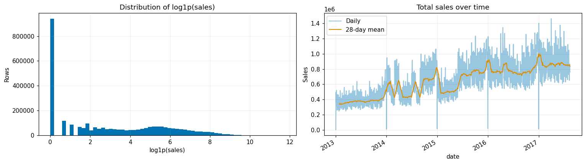
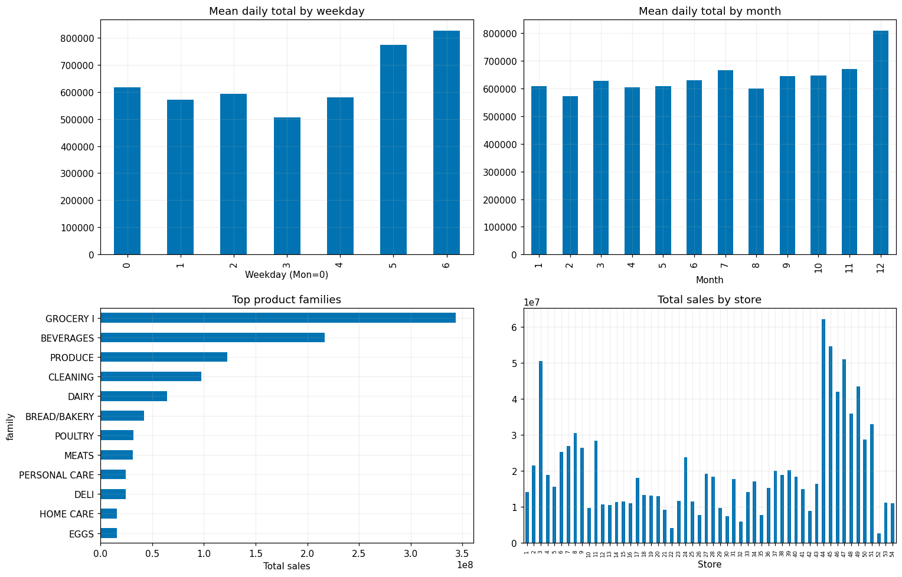
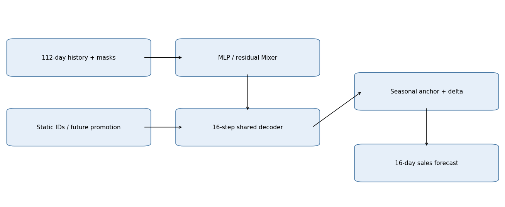
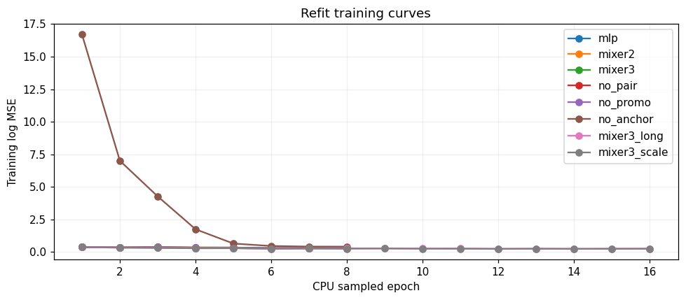
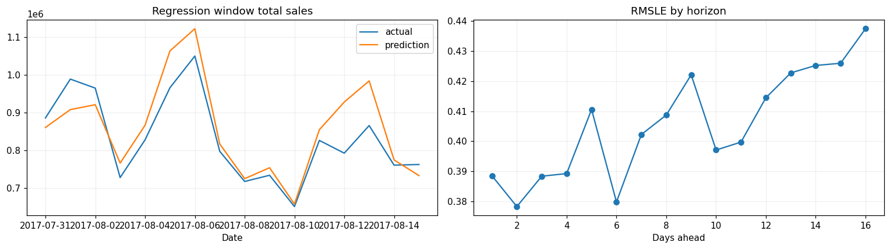

# Store Sales：商店销量时序预测数据分析报告

课程名称：机器学习

项目数据集：Kaggle – Store Sales: Time Series Forecasting

项目类型：多变量、多序列、16天直接多步回归预测

报告版本：基础版改进与CPU进阶实验

姓名：________________　　学号：________________

班级：________________　　指导教师：____________

报告日期：2026年11月17日

## 摘要

本项目以Kaggle Store Sales: Time Series Forecasting竞赛为研究对象，预测厄瓜多尔54家商店、33个商品品类在未来16天的销量。目标变量是sales（销量），并非商品价格。项目在基础LightGBM作业之上，完成数据探索、预测起点样本重构、最新历史特征、共享多步神经网络、滚动验证、消融实验、多种子复验及模型融合。

在同一组四个开发窗口上，增强树模型B3的合并RMSLE由基础模型的0.52949降至0.50178，相对改善5.23%，四个窗口均有提升。锁定后，在此前已经观察过的固定回归窗口上，RMSLE由0.42611降至0.40603。该窗口不能称为全新盲测。

本轮实际运行设备为CPU；网络采用宽度32、受限随机窗口训练，并保留真实结构对照。神经网络及对数融合未超过最强树模型，最终采用B3生成28,512条测试预测。完整GPU预算训练及真实Kaggle线上提交尚未执行，不填写Public Score。所有主要指标均有保存预测和独立复核记录。

关键词：销量预测；时间序列；LightGBM；共享嵌入；季节残差Mixer；滚动回测

### 报告结构

一、项目背景与研究目标；二、数据集介绍与探索性分析；三、数据预处理与特征工程；四、模型构建与评价方法；五、实验结果与模型比较；六、参数优化与融合分析；七、最终训练与Kaggle预测；八、结论与不足。

## 一、项目背景与研究目标

零售销量受周内周期、节假日、促销安排、门店规模和品类差异共同影响。准确预测可为备货和库存计划提供参考。本任务同时包含1,782条门店—品类日序列，既要刻画各序列差异，也要利用跨门店、跨品类的共同规律。

### 1.1 项目目标

（1）完成原始数据规模、缺失日期、零销量、促销及季节性的探索性分析。

（2）以预测起点T组织历史和未来已知输入，安全使用最新观测，并直接预测T+1至T+16。

（3）比较冻结基础模型、增强LightGBM、共享MLP与TSMixer风格网络，完成结构消融与多种子检验。

（4）在统一四窗开发协议下检验至少5%的合并RMSLE改善目标，再做固定窗口回归检查。

（5）生成可复核的Notebook、HTML、Word报告、模型权重和正式提交文件。

### 1.2 改进思路与实验边界

基础模型为避免多步预测泄漏，对目标日使用较远的销量滞后。本项目将‘目标日特征’改为‘截至预测起点的上下文’，从而在所有16个步长中共享最新1、7、14、28、56天信息。同时引入门店、品类和组合嵌入，采用季节锚点加残差的多步网络。

结构设计是否有效必须由同预算对照证明。更宽网络、更长训练和更早训练起点属于不同改动来源，不能把所有收益都归因于Mixer。最终提交依据同一开发协议的实际结果，允许选择单一树模型。

## 二、数据集介绍与探索性分析

### 2.1 数据组成与预测范围

| 数据文件 | 记录数 | 用途 | 原始空值数 |
| --- | --- | --- | --- |
| train.csv | 3,000,888 | 带销量标签的历史数据 | 0 |
| test.csv | 28,512 | 未来16天输入，无销量标签 | 0 |
| stores.csv | 54 | 门店城市、类型、cluster | 0 |
| holidays_events.csv | 350 | 节假日、事件及转移标记 | 0 |
| oil.csv | 1,218 | 历史油价 | 43 |
| transactions.csv | 83,488 | 历史门店交易笔数 | 0 |
| sample_submission.csv | 28,512 | 官方提交ID及列格式 | 0 |

训练数据覆盖2013-01-01至2017-08-15，包含1,684个实际有记录的日期。测试期为2017-08-16至2017-08-31，共有54×33×16＝28,512条预测记录。每条记录以日期、门店和品类确定，训练表未发现该组合键重复。

### 2.2 销量分布、趋势与周期

训练样本中零销量占31.30%，销量中位数为11，99%分位数为5,507。分布明显右偏，直接使用原尺度平方损失容易受到大销量样本影响，因此使用log1p变换与官方对数误差指标对齐。

总量曲线有长期水平变化和重复波动。周末平均销量相对较高，12月的月度均值较高；GROCERY I、BEVERAGES等品类及不同门店的量级差异明显。这些描述性图表支持加入日历、季节参照和层级共享信息，但不能据此作因果判断。

### 2.3 缺失记录与促销分布

原始train.csv没有字段空值，但2013—2016年每年12月25日均无记录。补齐日历面板时，必须将这些位置标为‘未观测’，不能当作真实零销量。油价表有43个原始缺失值；特征填补只沿过去方向进行，保留可用性信息。

训练表促销记录占20.37%，测试表为44.08%。二者分布有差异，且测试促销是竞赛明确提供的已知输入。该差异提示需要检验促销相关误差，不能仅凭整体历史均值推断未来。

## 三、数据预处理与特征工程

### 3.1 预测起点样本和标签边界

每个网络样本为（origin＝T，store，family），读取最近112天历史，输出未来16天log销量。树模型再将样本展开为（T，store，family，h），其中h＝1…16。每个训练起点必须满足T＋16天不晚于该折训练截止日，以保证所有训练标签在当时已经可知。

起点集合采用轮换星期的周抽样，并对最近56天保留可用日级起点。历史面板只存一份，按索引取窗口，避免为大量重叠样本重复复制原始数据。增强模型默认从2015年开始选训练起点，并用2016年起点范围作单独对照。

### 3.2 历史统计、掩码与类别表示

树模型包含最新观测、7/14/28/56天均值与波动、零销量比例、门店和品类汇总、最近同星期均值、364天季节参照，以及目标步长对应的已知促销与日历。B2单独加入截至起点的油价和交易信息。

网络历史输入包含log销量、促销、层级总量、历史外生量和观测掩码。归一化统计只使用当前样本截至T的有效历史；真实零销量仍参与计算。类别以整数索引进入嵌入表，门店、品类、组合的嵌入维度分别为8、8、16，商店类型及cluster作补充。

实验中发现树特征的缺失日占位值会污染历史滚动统计，随后将未观测位置转换为缺失标记，均值和标准差仅基于有效观测计算，零销量比例的分母也改为有效观测数。相关树模型已重跑，最终排名不使用修正前结果。

### 3.3 未来已知输入与防泄漏检查

| 信息 | 使用规则 |
| --- | --- |
| 销量、油价、交易笔数 | 来源日期≤T；油价不得用未来数据回填 |
| 促销、星期、月份、适用节假日 | 使用竞赛提供的排期或可预先确定的日历；回测保持同一假设 |
| 不可预知事件 | 不在事件发生前把它当作已知未来输入 |
| 缺失标签与真实零销量 | 缺失标签由掩码排除；真实零销量保留 |
| 模型选择 | 内层选择轮数，外层四窗用于开发；固定回归窗锁定后复评 |

自动检查包括未来销量扰动不改变当前输入、已知未来促销能够到达输入、训练标签边界、圣诞缺失日掩码及真实零销量保留。7项单元检查通过；保存的60组实验预测还经过原始标签连接和指标独立复算。

## 四、模型构建与评价方法

### 4.1 对照模型与结构设计

| 模型 | 核心改动 | 实验作用 |
| --- | --- | --- |
| B0 | 冻结基础LightGBM | 同四窗重跑的统一基准 |
| B1 / B1_2016 | 预测起点特征；比较训练起点范围 | 检验新信息和历史长度 |
| B2 / B3 | 历史外生量 / 受控树参数组 | 检验特征和参数收益 |
| 共享MLP | 相同历史、静态和未来输入的稠密编码器 | 简单网络对照 |
| 两/三层Mixer | 时间及特征混合、多步共享解码、季节残差 | 检验结构与深度 |
| no_pair / no_promo / no_anchor | 分别关闭组合嵌入、未来促销、季节锚点 | 以两层Mixer为单因素消融参考 |
| mixer3_long / mixer3_scale | 加长预算；再加入原始上下文尺度 | 区分训练预算与尺度信息的作用 |

Mixer块沿时间维和特征维分别执行MLP，包含LayerNorm、GELU、Dropout及残差连接。时间投影将112天表示转换为16步状态，再与未来特征、静态嵌入和步长嵌入拼接，用共享解码器输出修正量。该网络是TSMixer思想的任务适配实现，不宣称提出新的基础架构。

每个步长的季节锚点由截至起点最近同星期的有效log销量均值构成，缺失时采用历史回退。最终ẑ＝anchor＋delta，预测销量为expm1(max(ẑ, 0))。输出层修正量零初始化，使初始预测接近周期锚点。scale分支额外向解码器提供归一化前均值、尺度与起点水平。

### 4.2 评价指标与滚动验证

主指标RMSLE＝sqrt(mean((log(1＋ŷ)－log(1＋y))²))，数值越低越好。MAE和RMSE在原销量尺度计算，分别描述平均绝对误差和对大误差敏感的均方根误差；R²作为辅助解释度指标。销量可能按重量计量，不将预测强制取整。

| 窗口 | 预测日期 | 用途 |
| --- | --- | --- |
| D1 | 2016-08-16—2016-08-31 | 相近月份的季节回测 |
| D2 | 2017-04-16—2017-05-01 | 节假日与跨月检验 |
| D3 | 2017-06-15—2017-06-30 | 近期开发初筛 |
| D4 | 2017-07-15—2017-07-30 | 最近开发初筛 |
| R | 2017-07-31—2017-08-15 | 已观察过的固定回归检查 |

本任务不能随机打乱时间后按80%/20%划分。每折仅使用起点之前已知标签；网络训练轮数由训练期内部最后16天选择，随后固定轮数重训至外层起点。合并RMSLE将全部样本的平方对数误差汇总后开根；本轮每窗均为28,512行，因此也等于各折RMSLE平方均值的平方根，而不是各折RMSLE的算术平均。

### 4.3 实际训练预算

实际设备为CPU，基础网络宽度32、batch size 256，每轮随机4,096个序列窗口，内层比较2/8轮；long与scale采用每轮8,192个窗口，比较2/16轮。这是受限抽样轮次，不能解释为完整数据遍历epoch。损失采用有效标签上的log销量MSE，优化器AdamW，并使用梯度裁剪。完整GPU配置的宽度64、全窗口、最多50轮和patience＝6尚未实测。

以D4的scale模型为例，参数量为73,745，内层选定16轮，外层重训曲线记录耗时152.93秒。CPU耗时受并行资源共享影响，不作为专用硬件速度基准。

## 五、实验结果与模型比较

### 5.1 四窗树模型结果

| 开发窗口起始日 | B0 RMSLE | B3 RMSLE | 相对改善 |
| --- | --- | --- | --- |
| 2016-08-16 | 0.73024 | 0.68418 | 6.31% |
| 2017-04-16 | 0.52173 | 0.49366 | 5.38% |
| 2017-06-15 | 0.39387 | 0.38270 | 2.84% |
| 2017-07-15 | 0.40107 | 0.38582 | 3.80% |
| 四窗合并 | 0.52949 | 0.50178 | 5.23% |

B3在4个开发窗口均改善，达到合并RMSLE改善5%的目标。单窗改善约2.84%—6.31%，最小改善发生在D3，未出现开发窗口退化。新增四窗与基础版原先两窗并非同一组数据，不能把原先0.39144直接和新版四窗0.50178比较。

### 5.2 网络、深度与尺度信息

| 模型 | 四窗合并RMSLE | 预算/解释 |
| --- | --- | --- |
| B0 | 0.52949 | 增强树 |
| B1 | 0.50635 | 增强树 |
| B3 | 0.50178 | 增强树 |
| mlp | 0.61040 | 4096窗口/轮，2或8轮 |
| mixer2 | 0.61295 | 4096窗口/轮，2或8轮 |
| mixer3 | 0.60441 | 4096窗口/轮，2或8轮 |
| mixer3_long | 0.57927 | 8192窗口/轮，2或16轮 |
| mixer3_scale | 0.56345 | 8192窗口/轮，2或16轮 |
| no_pair | 0.61062 | 4096窗口/轮，2或8轮 |
| no_promo | 0.62058 | 4096窗口/轮，2或8轮 |
| no_anchor | 0.63429 | 4096窗口/轮，2或8轮 |

基础三层Mixer比两层稍好，long训练进一步改善，scale在相同加长预算下继续改善，说明保留原始上下文水平和尺度在本轮设置下有帮助。但scale四窗RMSLE仍为0.56345，未超过B3的0.50178；不能据此声称网络带来了最终提交增益，也不能把受限训练结果推广为充分GPU训练的上限。

### 5.3 受控消融与多种子检验

| 消融模型 | D3+D4 RMSLE | 相对两层Mixer差值 |
| --- | --- | --- |
| mixer2 | 0.42581 | +0.00000 |
| no_pair | 0.42498 | -0.00083 |
| no_promo | 0.42485 | -0.00096 |
| no_anchor | 0.43412 | +0.00831 |

移除未来促销或季节锚点后误差上升，支持保留这些信息。关闭组合嵌入的差异较小，应结合随机波动审慎判断；置零关闭后嵌入表仍注册在模型中，不能将该消融描述为参数压缩。

| scale模型随机种子 | D3+D4合并RMSLE |
| --- | --- |
| 42 | 0.40709 |
| 2026 | 0.40616 |
| 3407 | 0.41631 |

三种子的两窗RMSLE均值为0.40985，样本标准差为0.00561；小于随机波动的微小差异不视为显著提升。

三个种子的log预测平均后，两窗合并RMSLE由种子42的0.40709降至0.40232。该结果仅为两窗诊断，尚未完成四窗集成及正式测试集成提交，不能与四窗最终排名混用。

## 六、参数优化与融合分析

### 6.1 增强树的特征和参数对照

B1比较2015与2016起点范围，B2检验历史油价/交易输入，B3进一步比较树容量与直方图参数。先在D3、D4筛选，再将候选B1与B3扩展至四窗，依据四窗结果锁定。本次采用有限候选对照，结果仅反映这些已实际执行的特征及参数组。

| B3参数 | 实际取值 |
| --- | --- |
| n_estimators | 600 |
| learning_rate | 0.05 |
| num_leaves | 63 |
| min_child_samples | 80 |
| max_bin | 63 |
| colsample_bytree | 1.0 |
| reg_lambda | 1.0 |
| random_state | 42 |

B3使用600棵树、63个直方图bins及全列采样，与B1的350棵树、255 bins和0.9列采样作参数组比较。因此可确认整组设置有效，不能仅把提升归因于增加树数或某一个参数。

### 6.2 对数空间融合

将最强树与最强神经模型的外层预测按相同键对齐，采用z_blend＝w·z_tree＋(1－w)·z_network；预先限定全局权重w∈{0，0.25，0.5，0.75，1}。选择仅依据四窗开发数据，R窗口不回流调整权重。

| 树权重w | 四窗合并RMSLE |
| --- | --- |
| 0 | 0.56345 |
| 0.25 | 0.53861 |
| 0.5 | 0.51964 |
| 0.75 | 0.50720 |
| 1 | 0.50178 |

最优权重为1，即纯B3树模型，网络权重为0。保存网格标记blend_1.0只是端点命名，不能将其包装成有效的多模型集成收益。

### 6.3 模型解释

最终模型的7天滚动均值及同星期季节锚点增益占比分别约61.6%和28.9%，说明近期水平与周周期被模型大量使用。增益重要性只反映模型内部使用情况，受相关特征竞争影响，不等于因果贡献。

## 七、最终模型训练与Kaggle预测

### 7.1 锁定后的固定回归检查

| 模型 | RMSLE | MAE | RMSE | R² |
| --- | --- | --- | --- | --- |
| 基础B0 | 0.42611 | 76.18 | 267.47 | 0.9541 |
| scale网络 | 0.45323 | 73.37 | 260.19 | 0.9566 |
| 最终B3 | 0.40603 | 69.44 | 244.97 | 0.9615 |

固定窗口RMSLE相对基础模型改善4.71%，MAE和RMSE也下降，但未达到≤0.40的挑战目标。该结果在方案锁定后计算；由于该月份此前已被观察，其作用是回归检查，不能替代新的泛化验证。

| 固定窗口分组 | B0 RMSLE | 最终B3 RMSLE |
| --- | --- | --- |
| 无促销 | 0.47710 | 0.44539 |
| 促销 | 0.34987 | 0.34903 |
| 真实销量>0 | 0.42380 | 0.39916 |
| 真实零销量 | 0.43942 | 0.44417 |

整体提升不代表每个群体都改善：真实零销量组的RMSLE由0.43942升至0.44417；无促销组明显改善，促销组改善较小。后续可研究零销量相关结构，但必须在新开发回测中检验，不能依据这次固定窗口反复调参。门店、品类及逐步长诊断保存在group_diagnostics.csv中。

### 7.2 最终训练、提交格式与线上状态

最终训练截止2017-08-15，沿用已锁定配置，再预测2017-08-16至08-31。分别导出submission_final.csv、submission_tree.csv和submission_network.csv；最终文件位于outputs/advanced/，保留基础版根目录submission.csv作为历史对照。

| 检查项 | 实际结果 |
| --- | --- |
| 预测行数与列名 | 28,512行；id、sales两列 |
| ID | 唯一，顺序与官方sample_submission一致 |
| 预测数值 | 有限、无缺失、非负；不强制取整 |
| 模型权重复现 | 重新加载树/网络权重，可复现三份CSV；最大log差约1.06×10⁻⁷ |
| 报告和实验审计 | Notebook完整执行；60组保存预测的标签及RMSLE独立核验 |
| Kaggle Public Score | 待真实提交；当前无线上回执 |

当前未取得Kaggle线上成绩，本地固定窗口的0.40603不属于Public Score。实际线上表现需上传本项目提交文件后，以竞赛回执为准。

## 八、结论与不足

本项目按照数据探索、预处理、特征工程、建模、滚动评价、参数对照和最终预测的流程完成了CPU受限进阶研究。B3四窗合并RMSLE为0.50178，相对冻结基础模型改善5.23%，且四窗均提升；固定回归窗RMSLE为0.40603。最终选择纯增强树模型，神经网络及融合未在本轮条件下胜出。

### 8.1 项目贡献与学习总结

本项目的主要改进是以预测起点统一数据可用性，安全引入最新历史；为共享网络设计静态嵌入、未来已知输入和季节残差；通过消融、训练预算对照和多种子结果解释模型表现。修正缺失占位统计并重跑相关模型，也说明数据定义与评价协议对结论可信度至关重要。

### 8.2 不足与后续改进

（1）算力受限：宽度32和抽样轮次不代表完整GPU训练。已提供GPU入口，但未运行宽度64、全窗口、最多50轮的正式预算。

（2）开发月份有限：四窗参与了选择，固定回归窗又已被观察。需要新增月份回测及真实Kaggle回执，不能仅凭本地分数保证线上排名或课程成绩。

（3）网络与树信息并非完全相同：网络包含历史外生量等通道，B3采用其对应树特征。结构收益主要依据相同网络信息和预算下的MLP、Mixer及消融对照解释。

（4）消融范围有限：三项消融针对基础两层Mixer，没有覆盖最终scale分支的全部组合；长训练与尺度信息的收益应分别归因。

（5）集成验证尚不完整：三种子平均只完成近期两窗诊断，未形成完整四窗及正式测试集成提交。

（6）零销量误差仍有改善空间：可在新开发窗口研究零销量处理和更充分训练，且每项改动须有独立对照，不能靠增加结构复杂度宣称有效。

## 参考资料

[1] Kaggle. Store Sales: Time Series Forecasting. https://www.kaggle.com/competitions/store-sales-time-series-forecasting

[2] Chen et al. TSMixer: An All-MLP Architecture for Time Series Forecasting. 2023. https://arxiv.org/abs/2303.06053

[3] Das et al. Long-term Forecasting with TiDE: Time-series Dense Encoder. 2023. https://arxiv.org/abs/2304.08424

[4] LightGBM Documentation. https://lightgbm.readthedocs.io/

[5] PyTorch Documentation. https://pytorch.org/docs/

[6] Scikit-learn / Pandas Documentation. https://scikit-learn.org/ ; https://pandas.pydata.org/docs/

[7] 本项目实验记录：outputs/advanced/metrics.csv、leaderboard.csv、selection.json、group_diagnostics.csv、seed_ensemble_diagnostics.csv、independent_verification.json。

[8] House_Prices_数据分析报告.docx，课程报告示例。仅用于章节组织与排版参考。
