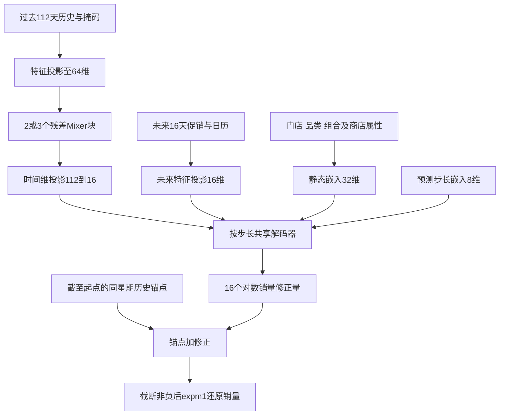

# Store Sales 进阶版：网络设计与实施计划

> **For agentic workers:** 实施时按 `superpowers:executing-plans` 逐任务推进；依照本项目的 `lean-software-delivery` 偏好，默认单代理执行。本轮交付设计与计划，训练结果须由后续实际实验产生。

**Goal：** 在可复现的基础版之上，提高跨时间窗口的销量预测精度，争取更好的真实 Kaggle 分数，并形成有结构设计、对照和消融证据的课程报告。

**Architecture：** 以“预测起点 T”为中心统一组织历史、未来已知信息和 16 天标签；建立增强 LightGBM、共享 MLP 和带静态嵌入及季节残差的 TSMixer 风格网络。通过滚动回测选择模型，并在对数空间验证融合收益。

**Tech Stack：** 沿用 Pandas、NumPy、LightGBM、Scikit-learn、Jupyter，增加 PyTorch；CPU 完成数据和树模型阶段，正式神经网络训练使用 Kaggle GPU 或同等设备。

**Spec：** 本文件第 1—7 节为设计规格，第 8—10 节为实施任务、验收与交付约定。

## 1. 改动范围与依据

采用“课程进阶版”的投入：保留基础版用于复现实验和对照，重构进阶版的样本组织、验证和训练流程。核心新增一个可解释、可消融的神经网络家族，并保留强树模型作为实际预测候选。

基础版本：`937fe5840828e5d68443b30637320db9dbc9456b`。当前已经证实的结果来自 `artifacts/`：

| 项目 | 已有证据 |
|---|---:|
| 最佳模型 | LightGBM，350 棵树，learning_rate=0.05，num_leaves=63 |
| 两个开发窗合并 RMSLE | 0.39144 |
| 2017-07-31—08-15 本地窗口 RMSLE | 0.42611 |
| 同一窗口周期基线 RMSLE | 0.61704 |
| 前 7 天 / 后 9 天 RMSLE | 0.41628 / 0.43360 |
| 整个窗口的预测总量偏差 | +4.13% |
| Kaggle Public Score | 尚无真实提交记录 |

这些数值不是 Kaggle 线上成绩。已有的 2017-07-31—08-15 窗口已经被观察过，新版将其称为**固定回归窗口**，不再包装成全新盲测。

主要机会：

1. 基础版只用至少滞后 28 天的销量。按预测起点构造样本后，可以安全利用截至 T 的最新历史，服务所有 16 个预测步长。
2. 使用共享网络学习 1,782 条门店—品类序列，在捕捉共性的同时用嵌入表示个体差异。
3. 显式输入未来已知促销和日历，直接输出 16 天，减少递归预测带来的误差累积。
4. 增加不同季节和节假日期间的回测，检验提升能否跨时间复现。
5. 增加受控消融、耗时和模型规模比较，使报告的设计依据与实验结论能够对应。

### 成功标准

- 工程底线：数据可用性检查通过，预测格式正确，报告可完整复现，分数来源清楚。
- 本轮性能目标：在同一组新增开发窗口上，相对重跑的基础模型，合并 RMSLE 改善 **5% 以上**；争取 4 个窗口中至少 3 个改善，同时报告最差窗口的退化幅度。
- 原固定窗口的挑战目标为约 **0.38—0.40**，它只是目标区间，不是预报或承诺。不得用它替代多窗口指标。
- Kaggle 改善必须以实际提交回执证明；没有回执时保留空值。
- 未达性能目标时明确报告差距。最终选择已验证最好的预测，神经网络未胜出也保留真实实验结果与分析。

## 2. 方案选择

| 路线 | 优点 | 取舍 | 本轮决策 |
|---|---|---|---|
| 增强时序特征与 LightGBM | 成本可控、强对照，有望改善近期信息利用 | 单独使用时，网络结构方面的课程贡献较少 | 必做 |
| 共享 MLP + TSMixer 风格多步网络 | 能结合历史、静态信息和未来已知特征，结构与消融容易解释 | 需要 GPU 实验和规范的数据切分 | 主线 |
| 大型 Transformer、很多架构或逐系列训练大量网络 | 可拓展研究范围 | 算力与搜索成本大，较难确定提升来自哪里 | 首轮不纳入；有额外资源与明确误差证据时另立实验 |

选用 Google TSMixer 的时间混合、特征混合与残差思想，并加入本任务的层级嵌入、16 步解码及季节残差路径。**这是有来源的任务适配设计，不宣称发明了新的基础模型。** TiDE 是同类稠密编码—解码思路的参考；首轮不再并行实现第二套复杂家族。

## 3. 从预测起点组织数据

### 3.1 样本定义

一个样本为 `(origin=T, store, family)`，输入截至 T 的历史，以及 T+1 至 T+16 已知的促销与日历，标签为这 16 天销量。树模型将其展开为 `(origin, store, family, h)`，`h=1…16`。

例如 T=2017-08-15、目标日=2017-08-31：可以使用 8 月 15 日销量和截至 15 日的近 7 天统计；不能使用 8 月 30 日真实销量，即使它被写成目标日的 `lag_1`。

每折训练样本必须满足 `origin + 16 days <= fold_cutoff`。原数据缺少的日期按缺失处理，标签用掩码排除；真实零销量仍参与训练与评分。

可用性元数据区分 `observed` 与 `future_known`：历史观测来源日期必须不晚于 T；未来促销与日历的目标日期可以晚于 T，但必须在获准的已知输入白名单中。促销排期已知是竞赛提供数据下的实验假设，不能伪造原始文件并未提供的发布时间。

### 3.2 数据可用性

| 数据 | 使用原则 |
|---|---|
| 历史销量、历史交易笔数、历史油价 | 来源日期不晚于 T。油价填补只能向前；初始缺失另设标记 |
| 未来 onpromotion | 竞赛测试表已提供；回测采用相同“促销排期已知”假设 |
| 星期、月份、15 日/月末、可预知节假日与补班 | 可为预测期构造；地区与城市假日只匹配适用门店 |
| 地震等不可预知事件 | 不能在事件发生前当作已知未来特征；已发生后的历史信号可以使用 |
| 门店与商品静态属性 | 静态输入，不使用目标编码的全样本统计 |
| 活跃状态、首次正销量日、近期零销量比例 | 仅由截至 T 的历史计算，不使用未来首次开售日期 |

### 3.3 历史特征

增强树模型增加截至 T 的最近 1/7/14/28/56 天历史、7/14/28/56 天滚动统计、近期趋势、过去同星期均值、零销量比例、历史活跃状态及促销强度。增加历史门店总量与品类总量作为共享信号。

对每个未来步长构造“截至 T 最近 4 个相同星期日”的历史统计，以及目标日对应的 364 天前销量和缺失标记；这些日期都必须在 T 之前。油价与交易笔数作为一组可单独消融的历史输入，不能掺入预测日真实值。

默认训练目标起点扩展为 **2015-01-01**；保留 **2016-01-01** 作为一次训练窗口对照。2013 年以来的原始记录可供历史特征查找，基线仍使用其原先设定。所有方法记录自己的训练标签范围，避免把训练时间窗收益归为网络收益。

先在相同的 2016 窗口比较 B0 与 B1，再比较 B1 的 2015/2016 窗口；随后锁定进阶模型共用的训练起点，再进行网络与消融比较。

控制样本规模：每个自然周选择一个起点，星期按周轮换；最近 56 天的可用起点每日保留，去重后使用。每折只保留标签完整可知的起点。不同星期均得到覆盖，避免固定每 7 天抽样导致起点星期单一。

网络和树使用相同起点集合。历史面板与掩码只存一份，按起点索引取窗口，不预先复制全部重叠的三维样本。先估计行数和内存，再构造树的 16 步长表；用 float32、类别编码和分批生成控制峰值。

## 4. 主网络：共享多步季节残差 Mixer

### 4.1 三类输入

1. **历史：** 过去 **112 天**的 log1p 销量、促销、历史门店/品类总量、观测掩码；历史油价与交易笔数为可消融扩展。输入形状为 `B × 112 × C`。
2. **未来已知：** 未来 **16 天**的促销、星期、月份、发薪日、适用节假日、历史可查的 364 天季节参照及缺失标记，形状 `B × 16 × F`。
3. **静态：** 门店 ID 嵌入 8 维、品类 ID 8 维、门店—品类组合 ID 16 维。商店属性经小型投影加入后，统一投影为 32 维。

一个样本对应一条系列，参数在所有系列间共享。Feature mixing 作用于该样本的历史特征维，**不把 1,782 条系列同时当作 1,782 个输入通道**。

历史连续输入的归一化只使用当前样本截至 T 的上下文和观测掩码；全零或常量历史使用安全尺度，并保留缺失标记。上下文水平与尺度可作为解码器输入。目标始终保留未标准化的 log1p 尺度，使训练损失与 RMSLE 对齐。

### 4.2 结构与默认规模



每个 Mixer 块包含：时间 MLP（112→64→112）、特征 MLP（64→128→64）、LayerNorm、GELU、Dropout=0.1 与残差连接。默认比较 2 块和 3 块，隐藏宽度固定 64；初始参数量目标为 **50 万以内**，实际实现后统计。

历史表示经时间维线性投影得到 16 个未来状态，与未来已知特征、静态嵌入及步长嵌入拼接，经过共享 `Linear→128→GELU→Linear→1` 输出修正量。

每一步的锚点为截至 T 的最近四个同星期日的 **log1p 销量均值**。缺失观测不当作零；没有有效同星期记录时退回同系列历史 log1p 均值，再无历史时退回截至 T 的可用品类统计，并明确标记。真实全零历史的锚点就是零。最后一层修正量可零初始化，使初始预测接近周期锚点。

`z_hat(T,h) = seasonal_anchor(T,h) + delta(T,h)`；推理时 `y_hat = expm1(max(z_hat, 0))`。目标是学习促销、近期趋势和门店差异带来的修正，一次输出所有 16 步，不回填窗口内真实销量。

### 4.3 训练设置

- 损失：所有有标签位置的 `mean((z_hat - log1p(y))²)`；有效标签等权，不按销量规模加权。
- 优化器：AdamW，初始 learning_rate=0.001，weight_decay=0.0001，梯度裁剪 1.0。
- Batch size 默认 512，显存不足先降为 256/128；GPU 支持时使用混合精度，损失与评分保持 float32/float64 的稳定计算。
- 最多 50 epochs、patience=6；记录学习曲线、最优 epoch、训练/推理耗时、参数量与显存峰值。
- 每个外层窗口只用其训练期内部的最后 16 天选择早停轮数，再用截至外层起点的全部可用训练标签训练固定轮数。外层真实标签不参与早停。
- 固定并记录 Python、NumPy、PyTorch 的随机种子及设备/库版本；GPU 小数位差异不能伪装成结构收益。
- 共享 MLP 使用相同的历史、未来和静态输入，历史展平后通过稠密编码器解码 16 步，作为结构复杂度对照。

## 5. 验证、消融与融合

### 5.1 时间窗口

| 用途 | 预测日期 | 作用 |
|---|---|---|
| D1 | 2016-08-16—08-31 | 与正式测试月份相近的季节回测 |
| D2 | 2017-04-16—05-01 | 节假日及跨月变化 |
| D3 | 2017-06-15—06-30 | 较近期月份 |
| D4 | 2017-07-15—07-30 | 最近期开发窗口 |
| R | 2017-07-31—08-15 | 已观察过的固定回归窗口；锁定新版后复评 |
| Kaggle | 2017-08-16—08-31 | 真实线上评价，不能用本地标签评分 |

每个窗口训练均只使用起点以前标签。重跑基础 LightGBM 在 D1—D4 的结果后，才能计算新版相对收益。合并主指标必须由所有有效样本的平方对数误差合并后开根，不能把各折 RMSLE 简单平均当作同一指标。

先在 D3、D4 单种子初筛，再将最强候选扩展至 D1—D4。所有外层训练都遵守完整 16 天标签的时间边界。最终结构、参数、融合权重锁定后，只对 R 复评；不得围绕 R 反复调整到满意。

### 5.2 实验矩阵

| 编号 | 实验 | 检验的问题 |
|---|---|---|
| B0 | 原 LightGBM 按新增窗口重跑 | 统一比较基准 |
| B1 | 预测起点样本 + 最新历史的增强 LightGBM | 新样本组织与信息利用的收益 |
| B2 | B1 增加历史油价、交易笔数一组特征 | 外生输入有无稳定增益 |
| N0 | 相同信息的共享 MLP | 简单神经网络对照 |
| N1/N2 | 完整 Mixer，分别 2/3 块 | 混合结构和深度的收益 |
| A1 | 最佳完整网络去除组合 ID 嵌入 | 个体化表示是否有效 |
| A2 | 最佳完整网络去除未来促销 | 已知未来促销的增益 |
| A3 | 最佳完整网络去除季节残差路径 | 周期先验与残差设计的增益 |
| E | 最强树与最强神经模型的对数融合 | 模型误差是否互补 |

神经结构首轮最多 6 种配置（N0、N1、N2、A1、A2、A3），不扩成大规模全排列。归因时比较相同数据窗、同一起点和同一特征集合：B0→B1 的提升不声称来自网络，N0→完整 Mixer 才用于讨论结构变化。所有消融保留相同训练预算。

基础种子为 42；最终神经候选在 D3、D4 追加 2026、3407 两个种子，报告均值和标准差。若差异小于波动范围，不把小数点后的微小变化写成显著提升。3 个种子的 log 预测平均后仍须在开发预测上验证。

每个实验报告：合并及逐窗 RMSLE、MAE、RMSE、训练耗时、推理耗时和模型规模。进一步分门店、品类、零/非零销量、促销/非促销、预测步长，解释提升和退化发生在哪里。分组只用于诊断，不据此事后修改官方样本权重。

### 5.3 融合规则

从各折未参与拟合的外层预测构造 OOF 表，统一用 `(origin, store, family, h, target_date)` 对齐。

`z_blend = w * log1p(y_tree) + (1-w) * log1p(y_network)`，`y_blend = expm1(z_blend)`。

全体样本只选一个全局权重，预先限定 `w ∈ {0, 0.25, 0.5, 0.75, 1}`；在 D1—D4 的 OOF 上选择并报告逐窗表现。包含两端，允许最后选择单模型。不为 33 个品类各调一套权重。R 只做锁定后的复评，Kaggle 分数不反向用于反复寻找权重。

## 6. 算力与试验预算

当前任务环境未检测到 `nvidia-smi`，尚未确认可用 GPU。默认神经训练在 Kaggle GPU Notebook（T4 或相近设备）进行；CPU 阶段可先完成，完整网络实验以可用 GPU 为关键依赖。没有 GPU 时可以调试小批样本，但不能声称已经完成正式训练。

首轮预算建议：**CPU 数据/树模型试验约 1—2 小时预算，GPU 训练上限 6—8 小时**，以现有可用的 Kaggle GPU 配额为基础。这是投入上限，不是预估完成时间或性能保证。

执行前先测一个训练窗口、5 个 epoch 的吞吐、数据加载、内存和显存，根据实测估算完整实验。优先完成共享数据、强树、MLP、主网络、多窗口回测及关键消融；多种子扩展后置。含内层早停后重训，完整筛选与扩展可能约 40 次小模型拟合，必须纳入预算。预计超额时先减少追加种子或深度候选，记录删减及原因；不删除防泄漏检查和固定窗口复评。

神经模型若不能稳定超过增强树，检验融合互补性；若融合也没有证据支持提升，选择树模型作为最终提交，并保留网络的实际实验结论。只有发现明确剩余误差且资源充足时，再单独评估更复杂网络或零销量专门结构。

## 7. 工程结构与全局约束

```text
Store_Sales.ipynb / Store_Sales.html / submission.csv  # 现有基础版
configs/advanced.yaml                                # 起点、窗口、种子、预算、模型参数
src/store_sales/data.py                              # 日历面板、掩码、可用性元数据
src/store_sales/windows.py                           # 起点索引、16步标签与数据集
src/store_sales/features.py                          # 截至T的统计与季节锚点
src/store_sales/models/tree.py                       # 增强LightGBM
src/store_sales/models/mlp.py                        # 共享MLP对照
src/store_sales/models/mixer.py                      # 多步残差Mixer
src/store_sales/training.py                          # 内层早停、固定轮数重训
src/store_sales/evaluation.py                        # OOF、官方指标、分组诊断与融合
scripts/run_advanced.py                              # 可续跑实验入口
scripts/export_advanced.py                           # 结果整理、报告与提交检查
tests/test_asof.py / test_windows.py / test_models.py / test_evaluation.py
outputs/advanced/                                    # 各实验指标、OOF、图表、manifest
Store_Sales_Advanced.ipynb / Store_Sales_Advanced.html
Store_Sales_Advanced_Assignment.zip
requirements-advanced.txt
```

模块文件随对应任务创建，不先建立空框架。模型权重和大型缓存默认不提交普通 Git；保留 checkpoint 元数据、配置、代码版本和数据哈希，必要时使用仓库 Release 交付权重。报告与小型核验结果进入 Git。

**Global Constraints：** 预测长度固定 16 天；官方目标是逐记录 RMSLE；缺失不当作零；日期可用性以 origin 为准；外层标签不用于早停；所有模型保留原始 ID 映射；所有指标由实际运行生成；未来事件可用性必须注明；基本版已有分数不称全新盲测。

**Review Focus：**

1. 跨预测步长引用窗口内真实销量：固定模型参数，扰动起点之后的 sales，history、future_known、static、anchor 及预测必须不变；target 可以变化但不能进入 forward。
2. 圣诞节缺失、真实零、全零历史混淆：掩码只排除缺失标签，零销量正常计入损失。
3. 起点重叠与训练标签越界：每条训练样本的标签末日不晚于该折 cutoff。
4. 归一化、锚点与首次开售日期引用未来：来源时间断言必须覆盖所有输入分支。
5. OOF、模型输出与提交 ID 对齐错误：按唯一键连接，不依赖数据行位置；整体 RMSLE 独立复算。

## 8. 按依赖执行的任务

### T1：冻结对照与实验协议

**文件：** 新增 `configs/advanced.yaml`，更新 README 中的进阶版说明；基础版文件作为对照。

- [ ] 记录基础提交、原始数据哈希、原分数和当前线上分数为空的状态。
- [ ] 写入 D1—D4、R、16 天长度、训练起点、起点抽样规则、种子与预算。
- [ ] 输出统一实验清单；预先定义融合权重候选与性能目标。

**验收：** 配置可读取，所有日期范围有效；与基础版指标来源逐项核对。

### T2：可用性一致的数据与起点样本

**文件：** 新增 `data.py`、`windows.py`、`features.py` 与 `tests/test_asof.py`、`tests/test_windows.py`。

**接口：** `build_panel(data_dir)` 返回带日期和系列映射的面板与 observed_mask；`build_origins(panel, cutoff, config)` 返回训练/验证起点；`make_inputs(panel, origins, config)` 返回 history、future_known、static、anchor、target、target_mask 及来源日期/可用性类别。

- [ ] 先构造跨缺失日、零销量和窗口边界的小样例，验证完整日历与 16 步标签。
- [ ] 加入未来目标扰动检查、窗口边界检查及假日匹配后行数检查，确认错误实现会失败。另测修改已知未来促销会改变 future_known 输入，避免错误地屏蔽所有未来信息。
- [ ] 实现按起点组织的历史与未来输入，统计样本数及预计内存，限制复制。
- [ ] 在小样例及真实数据抽样上核验时间来源与原始销量值；用第一组回测数据跑通取数。

**验收：** `python -m pytest tests/test_asof.py tests/test_windows.py -q` 通过；全部输入来源合法、标签掩码正确、原 ID 可回溯。该输出解锁后续全部模型。

### T3：重跑原模型与增强树模型

**文件：** 新增 `models/tree.py`、`evaluation.py`、`run_advanced.py` 的树模型路径。

**接口：** `fit_tree(train_rows, config)` 返回模型；预测输出统一 OOF 表，含键、真实值、预测、模型名、fold 和来源版本。

- [ ] 在 D1—D4 重跑固定基础模型，形成新开发窗对照。
- [ ] 在 D3/D4 验证 B1，并单独比较 2015/2016 两个训练目标起点。
- [ ] 增加 B2 外生特征组；只将稳定候选扩展至四窗。
- [ ] 保存 OOF、耗时、特征重要性和配置，不运行原版随机森林的大规模重复搜索。

**验收：** 合并误差可独立复算，样本与起点对齐；有可复现的最强树结果及退化窗口说明。无论其是否达到目标，均作为神经模型的强对照。

### T4：实现、校验与训练共享 MLP 和 Mixer

**文件：** 新增 `models/mlp.py`、`models/mixer.py`、`training.py`、`requirements-advanced.txt`、`tests/test_models.py`。

**接口：** `forward(history, future_known, static, anchor)` 返回 `B×16` 的 z_hat；`fit_network(train_set, inner_validation, config)` 返回权重、选定 epoch、学习曲线和资源记录。

- [ ] 验证输出形状、全零/缺失输入的有限性、掩码损失、锚点退回规则及小批样本可拟合性；复用 T2 样例验证固定权重下的未来销量扰动不会改变预测。
- [ ] 跑 5 个 epoch 实测吞吐，确认 GPU 和完整实验预算。
- [ ] 用相同输入训练 N0，再比较 N1/N2；外层窗口前按内层早停轮数回填重训。
- [ ] 记录参数量、内存/显存、曲线与版本；保存可续跑 checkpoint 和 manifest。

**验收：** `python -m pytest tests/test_models.py -q` 通过；D3/D4 的训练过程可复现且没有外层标签参与拟合；网络比较使用相同信息集。

### T5：消融、多窗口确认与融合

**文件：** 扩展 `evaluation.py`、`run_advanced.py`，新增 `tests/test_evaluation.py`。

**接口：** `score_oof(predictions)` 生成整体和分组指标；`blend_oof(tree_oof, neural_oof, weights)` 返回候选权重结果与锁定配置。

- [ ] 在 D3/D4 完成 A1—A3，对归因进行核对。
- [ ] 将最强候选扩展至 D1—D4，资源允许时补齐神经候选的多个种子。
- [ ] 按唯一键合并 OOF，验证 log 空间融合，在预定权重中选一项。
- [ ] 锁定所有参数后运行 R，报告改进比例与不利分组；记录是否达到目标，禁止用 R 重调。

**验收：** `python -m pytest tests/test_evaluation.py -q` 通过；消融表完整，融合可被重算，最终选择有多窗口证据。若网络或融合未胜出，如实选择最强候选，不伪造提升。

### T6：最终训练、真实提交与课程报告

**文件：** 新增 `export_advanced.py`、进阶 Notebook/HTML、作业包、`outputs/advanced/final_selection.json` 和提交记录。

- [ ] 根据各折内层选择的轮数确定最终固定训练轮数，训练至 2017-08-15；未来输入只包含获准使用的信息。
- [ ] 导出增强树、最佳神经模型及锁定最终方案的 CSV，各 28,512 行，保持测试 ID 顺序。
- [ ] 实际提交基础版与最终方案到 Kaggle，并记录提交文件哈希、实际分数和时间；如提交增强树/网络用于对照，最多再增加两类。提交受账号登录和竞赛规则约束。
- [ ] 导出完整报告，包含网络结构图、损失依据、学习曲线、统一对照、消融、多种子波动、误差切片、复杂度和真实线上结果。
- [ ] 独立核验 CSV、指标、HTML 图表、报告与配置一致性；将完成的进阶成果提交同一 GitHub 仓库并验证下载链接。

**验收：** 从输入数据到预测的流程可重跑，HTML 可独立查看，下载包可获取；线上成绩以实际回执为准。没有提交回执时，交付状态明确标记“线上评价待完成”。

## 9. 作业报告重点

建议题目：**《融合历史、促销与层级嵌入的商店销量多步预测：梯度提升与季节残差 Mixer 的比较》**。

重点写清五件事：为什么按预测起点建样本；为什么使用 112 天输入和 16 步输出；嵌入、未来促销和季节残差分别解决什么问题；用消融证明或否定这些设计；本地多窗与 Kaggle 的表现是否一致。

课程评分细则尚未提供，因此不把“使用某种网络”当作必然加分条件。用规范比较、结构解释、真实结果和复现材料支撑作业质量。已有 EDA 可复用，新增图表聚焦网络与实验结论。

## 10. 当前状态、下一步与参考

当前完成：基础版审阅、误差诊断、文献依据和本计划。进阶网络与新特征的收益尚未实验验证。

下一步先执行 **T1、T2**，建立统一的预测起点数据接口与防泄漏检查；通过后才训练增强树和网络。计划依赖关系为 `T1→T2→T3/T4→T5→T6`；默认由同一执行者顺序推进，按资源安排训练。

参考：

1. [Google Research：TSMixer](https://research.google/pubs/tsmixer-an-all-mlp-architecture-for-time-series-forecasting/)；[架构与静态/未来特征扩展说明](https://research.google/blog/tsmixer-an-all-mlp-architecture-for-time-series-forecasting/)。其零售实验是设计依据，不能直接转化为本竞赛收益保证。
2. [Google Research：TiDE](https://research.google/pubs/long-horizon-forecasting-with-tide-time-series-dense-encoder/)。
3. [Kaggle 数据说明](https://www.kaggle.com/competitions/store-sales-time-series-forecasting/data)、[评价规则](https://www.kaggle.com/competitions/store-sales-time-series-forecasting/overview/evaluation)。
4. 本仓库基础版 `artifacts/run_summary.json`、`development_leaderboard.csv`、`holdout_predictions.csv` 和 `family_errors.csv`。
